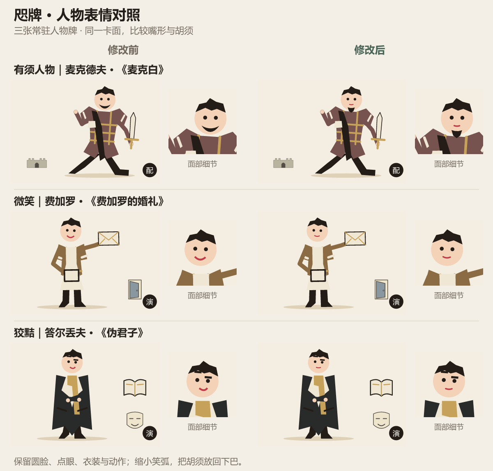

# v51 · 稀有度显示、逐颗亮星与自然表情

Git 提交日期：2026-11-14（UTC+08:00）。此日期来自提交记录，不表示精确部署时刻。

[提交 99392d3](https://github.com/canoeliu917/DiaGacha/commit/99392d3509bccf9b2c7fff62acd615794d01316a) · [该提交的源码快照](https://github.com/canoeliu917/DiaGacha/tree/99392d3509bccf9b2c7fff62acd615794d01316a)

## 改动

- 放大抽卡稀有度名称与星标，调整六卡总览中徽记的纵向排列和手机字号，便于辨认。
- 5–7 星卡在纸幕移除、揭晓完成后逐颗亮星；1–4 星不加入该等待与逐颗入场效果。
- 最后一张正常揭晓的高星卡完成后停留 1500 毫秒再进入总览，七颗星全部亮起后仍留有 480 毫秒观看时间。
- 跳过或减少动态效果时直接显示全部星星，末张等待用户操作；详情返回不重播，离开页面清理待执行动画与自动总览。
- 将有须人物的黑色新月“大笑口”改为自然小嘴与下巴独立短须；收窄普通微笑和狡黠笑弧。保持原有点眼、眉形、头发及其他脸型。

表情修改直接覆盖 41 张常驻人物牌：有须 9、微笑 19、狡黠 13；其中主角 19、配角 22。包含预留人物时共 42 张；这些数量不重复计入同一人物在剧目卡等场景中的出现次数。

## 当时的验证

- [全套自动测试记录](../docs/validation/v51-tests.txt)：142 项通过，无失败或跳过。
- 揭晓回归覆盖纸幕后才亮星、最后一张的停留时间、跳过、减少动态效果、详情返回及退出清理。
- 表情回归覆盖小嘴与下巴胡须分离、笑弧范围、点眼位置和脸型区分；源函数对照确认其余 13 种脸型以及头发、头部函数未改动。
- 从旧提交 `2c1eb7f` 与本版真实 Ct 渲染生成麦克德夫、费加罗、答尔丢夫的前后对照，分别代表有须、微笑与狡黠。三张完整造型配置前后一致，已目视检查全身与同一卡面的脸部放大。

## 验收边界

浏览器预览服务连接超时，本版手机动效未完成实际目测。320／390／840 像素宽度的七星徽记已按样式作静态宽度推算，但这不等于真实 DOM 或实体手机验收。

本版未更改分数、星级分档、抽率或卡牌内容。逐颗亮星的时序来自实现与自动检查，不能据此宣称所有设备都达到特定帧率。现有证据也不构成实体 iPhone、微信所有版本或系统相册保存菜单已实测通过的证明。

## 发布核对

GitHub Pages 已构建本页对应的固定提交，公开入口返回 HTTP 200，线上 HTML 与本地验收文件在统一换行后相同；原 Sites 镜像同步发布成功。

此页记录可追溯的提交、测试与真实卡面对照；固定源码快照用于历史查阅，不是独立部署的历史试玩站点。

[返回版本总日志](../CHANGELOG.md)
