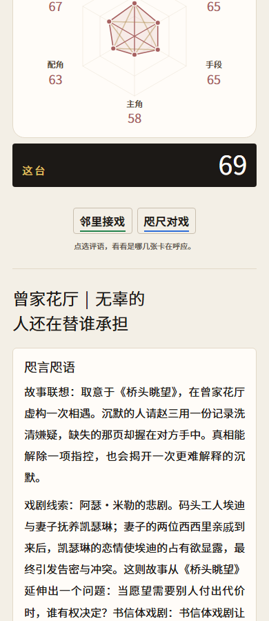

# v52 · 与故事契合的主标题

提交日期：2026-11-14（UTC+08:00）。

[提交 d8eb867](https://github.com/Canoeliu917/DiaGacha/commit/d8eb8677d54b24d074c8a3372003a819497dc435) · [固定源码快照](https://github.com/Canoeliu917/DiaGacha/tree/d8eb8677d54b24d074c8a3372003a819497dc435)

## 改动

- 解决大量组合反复使用“少掉的那一页是谁拿走的”等固定主标题的问题。新增 224 个独立标题，按 20 个专属故事、6 类共用故事、画展资助与独角故事分别组织，每组 8 个。
- 标题取材于当前正文中的愿望、冲突、行动与后果。先匹配故事分支，再根据六个维度的卡片 ID 稳定选题；同一组卡在重新打开、分享链接及长图渲染中保持同题，调整输入顺序不影响标题。
- 500 张常驻卡组成的六卡故事可选出 200 个标题；另 8 个用于兼容旧五卡独角故事，16 个用于两部预留剧目。224 是标题库数量，不代表新增 224 种剧情。
- 保留空间前缀。标题超过 35 字时只移除空间前缀，保留已经选定的主标题，避免旧五卡回退到双人故事标题。

本版不改卡池、评分、抽率、收藏数据、故事正文或分享链接格式。它增加同一故事的标题视角，不能保证不同组合绝不重名。

## 验证

- [完整自动测试记录](../docs/validation/v52-tests.txt)：150 项全部通过，无失败、跳过或取消。首次全套运行遇到旧测试的 Python 与 Resvg 环境缺项，复用本机 Python、在仓库外补齐 Resvg 后重新通过，未改变游戏依赖。
- 新增 6 项标题回归：500 张常驻卡的生成与稳定性、六维变化、标题丰富度、28 组故事匹配、独角与画展特例、页面内嵌源码一致性。旧实现先运行该组测试，2 项通过、4 项失败；新实现全部通过。
- [标题统计](../docs/validation/v52-title-stats.json)：同一固定种子的 2,000 组常驻组合，去掉地点前缀后由旧版 24 种增至 190 种；另遍历 7,500 组剧目与演法组合，实际覆盖全部 200 个常驻六卡标题。
- [浏览器记录](../docs/validation/v52-browser.json)：Chrome 在 390 与 1280 像素视口各检查当前用户组合、庄园交接、画展资助、旧五卡独角故事。8 个页面的实际标题与生成函数相同，无脚本异常、标题溢出或横向页面溢出。
- 已目视检查手机上的当前组合与桌面画展组合。此为桌面 Chrome 的视口测试，不代表实体手机或微信内核测试。

## 发布

[GitHub Pages 构建](https://github.com/Canoeliu917/DiaGacha/actions/runs/43500496994)已成功；公开入口返回 HTTP 200。线上 HTML 与验收文件统一换行后完全相同，SHA-256 均为 `5dd4882dc286a2838c8e44f7833150a07328cc3c2cc5d85493c71424d54fd969`。本次更新针对 GitHub Pages；原 Sites 镜像未同步本次版本。

[返回版本总目](../CHANGELOG.md)
