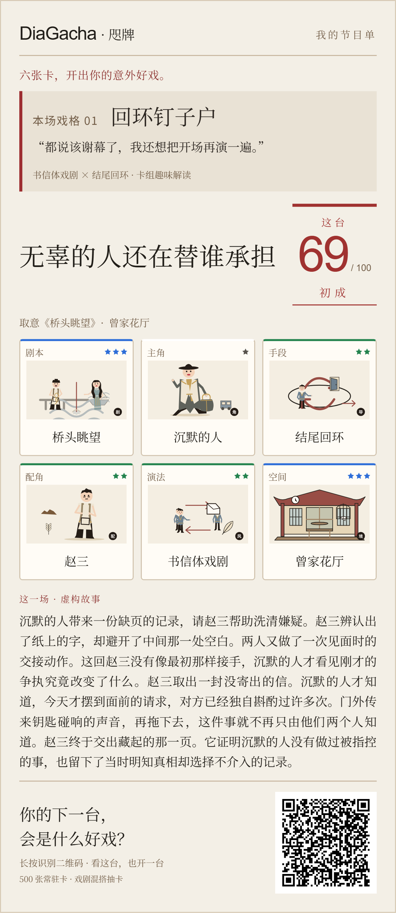

# v53 · 六张卡，开出你的意外好戏

提交日期：2026-11-14（UTC+08:00）。

[提交 0c74643](https://github.com/Canoeliu917/DiaGacha/commit/0c746437565add57807c474d7a43b736c180cc3e) · [固定源码快照](https://github.com/Canoeliu917/DiaGacha/tree/0c746437565add57807c474d7a43b736c180cc3e)

## 玩法与重复

结算后可以从已收藏的同维卡中替换一张。选择时预览新故事、主标题、整台分、同星与羁绊变化；允许为喜欢的故事选择降分组合。确认后使用当前卡组生成故事、链接和图片，保留初始卡组与原分数。刷新、最近节目单和页内返回不会重新发放同场改写机会。

综合包保留5／6／7星基础单席概率，给1–4星单张卡设置同维8%上限，按原权重重新分配超出部分，缓解原有44%热点。单卡数值、评分公式、500张常驻身份及旧收藏不变。帮助页展示重新分配后的真实出率。

固定种子30000包的[实际运行记录](../docs/validation/v53-balance.json)：旧三热点至少一张由82.52%降至21.56%；20组收藏会话中，100包平均收藏由189.60增至215.45张。1000包的收藏长尾基本不变，任一羁绊触发率由5.01%降至4.437%，不能宣称所有指标都提高。[概率与边界](../docs/RATES.md)

## 故事与专业内容

- 综评改为五段连续故事，讲清六张卡如何形成愿望、阻力、事件与后果；专业定义不再冒充故事结尾，也不加入排练建议。
- 75种演法、75种手段各有独立事件文案，正文和摘要都体现变化；空间以进出、私密性、到站时间等具体限制参与故事。
- 专属人物动机从14增至43。修正女性被称为“他”、无声人物被写成开口说话，以及车厢收留情节的离开矛盾。卡特琳与沉默的人使用动作或文字版本。
- 三张手段卡的独立知识说明跳过空泛分类句，保留实际定义。原有卡片来源、专业注释、事实核查与评分边界保留。
- 仍有25个常驻故事主干、224个标题；并非新增100套独立剧情，也未宣称185个人物都已独立精修。

## 界面与分享

首页以“六张卡，开出你的意外好戏”连接抽卡、改写与分享。结果先显示真实最终分数、戏格、卡组与故事，再提供进一步操作和评分详情。

12种“本场戏格”由实际演法与手段稳定生成，包括回环钉子户、证据收藏家、留白造梦师、现场接招王等。称号与金句是卡组的趣味解读，不伪造心理测量或人群百分位。

朋友圈图使用1170像素宽PNG，包含戏格、金句、剧名、真实评分、完整卡名、卡面、故事与组合二维码。支持复制文案、原生分享及原有完整长图。生成期间切换卡组或离开页面会丢弃旧导出，避免旧图覆盖当前结果。

图鉴每页48张，支持维度筛选、排序与翻页；长卡名换行完整显示。弹层移入焦点、限制Tab范围、支持Escape并返回原按钮，背景不可操作；保留柔和动效和减少动态效果设置。

## 存档与验证

自动保存未完成卡包和最近5个节目单。恢复不重新抽取或消耗奖励；兼容旧五卡、单维包和旧收藏。浏览器存储写失败时保留当前内存收藏并提示，修复连续收藏只剩最后一张的问题。

- [完整测试记录](../docs/validation/v53-tests.txt)：186项通过，0失败、0跳过。覆盖评分、人物与卡面数据、SVG、标题、故事、概率、改写、恢复、分享与源码内嵌一致性。
- 新故事回归覆盖500张常驻卡、75×2种正文及摘要变化、100剧目的女性代词、无声人物与独角兼容。摘要10000组抽样最长284字，不截断半句。
- [浏览器流程记录](../docs/validation/v53-browser.json)：实际点击完成开包、刷新继续、结算、收藏换卡、刷新保留改写、弹窗Tab／Escape、图鉴分页及筛选复位；320／390／768／1280像素视口无横向溢出，未记录脚本异常。
- [导出记录](../docs/validation/v53-poster-checks.json)：4组1170像素宽分享图实际像素解码成功，二维码还原对应卡组；包括旧五卡及最长卡名组合。完整长图780×5740像素正常导出。长卡名在320／390／1280像素页面完整显示。
- 同机Chrome模拟4倍CPU降速，图鉴点击至两帧绘制约110毫秒；此前全量图鉴约738毫秒。是开发环境观测，不是实体手机性能承诺。

“9分”作为本轮产品质量目标，以上是可复核的交付验收。未进行真实用户长期试玩、实体iOS／微信内核测试或朋友圈传播实验，因此不将自测冒称为玩家评分、绝对无缺陷或传播保证。

## 发布

[GitHub Pages构建](https://github.com/Canoeliu917/DiaGacha/actions/runs/43512158288)发布此代码。公开入口返回HTTP 200，线上HTML与验收文件统一换行后完全一致，SHA-256为`576ea8ea431c82e2f50e2296180d2ad18aad7fe2180abe3da20bcf623a5a9221`。原Sites镜像不属于此次更新入口。

[打开游戏](https://canoeliu917.github.io/DiaGacha/?v=53) · [返回版本总目](../CHANGELOG.md)
