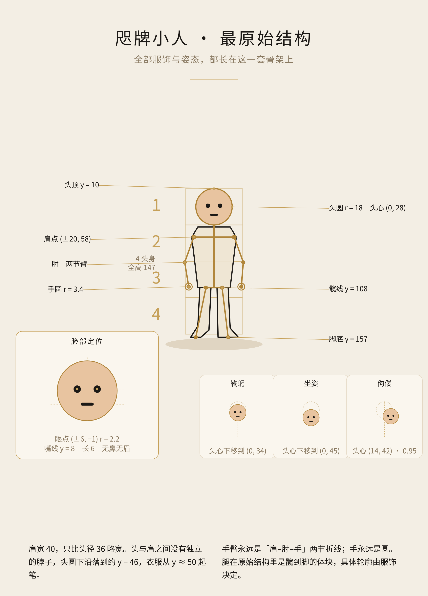
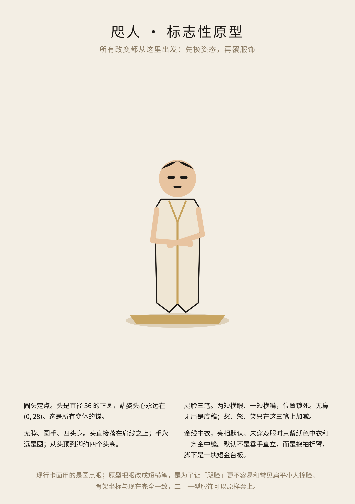
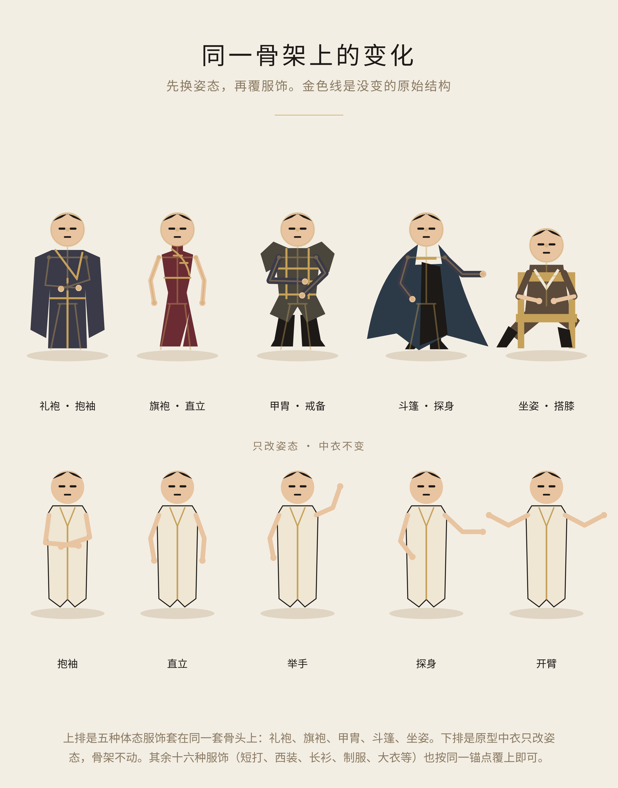

# 咫牌小人 · 设计图纸

这是 DiaGacha·咫牌 纸人的设计图纸与结构说明。

骨架坐标取自现行游戏（`art-figures-v39.js`、`figure-head-v49.js`，v39 起沿用至 v53）。全部 21 种服饰和 16 种姿态，都长在同一套骨头上。

「咫人」原型（纸色金线中衣、抱袖亮相、短金台板、短横眼）是设计方案，**尚未写入游戏**。现行卡面仍用圆点眼，人物直接穿 21 型服饰，没有单独的中衣底稿。

## 图纸

### 1. 最原始结构

正圆头、四头身、两点肩、两节臂、圆形手，以及脸部定位。鞠躬、坐姿、佝偻只移动头的锚点，骨架本身不变。

### 2. 咫人原型

同一套骨头上的标志性底稿：纸色金线中衣、默认抱袖亮相、脚下短金台板。脸为两短横眼加一短横嘴，位置仍锁在现行眼线与嘴线上。

### 3. 同一骨架上的变化

上排：礼袍、旗袍、甲胄、斗篷、坐姿套在同一套骨头上（金色线是没变的原始结构）。下排：原型中衣只改姿态。

可浏览的矢量源稿见 [source/](source/)。重新出图可运行 `source/build.py`。

## 骨架坐标

坐标系与游戏 SVG 一致：原点在身前，**y 向下**。站姿默认如下。

| 部位 | 坐标 / 尺寸 |
| --- | --- |
| 头圆半径 | `r = 18`（头径 36） |
| 站姿头心 | `(0, 28)`，缩放 `1` |
| 头顶 | `y = 10` |
| 头圆下沿（无独立脖子） | `y = 46` |
| 衣服起笔 | `y ≈ 50` |
| 肩点 | `(-20, 58)`、`(20, 58)`，肩宽 40 |
| 髋线（中衣） | `y = 108` |
| 手 | 圆，`r = 3.4` |
| 脚底 | `y = 157` |
| 全身高 | 约 147，即 **4 头身** |

手臂永远是「肩–肘–手」两节折线；手永远是圆。腿在原始结构里是髋到脚的体块，具体轮廓由服饰决定。

### 头锚点例外

| 情况 | 头心 | 缩放 |
| --- | --- | --- |
| 站姿（默认） | `(0, 28)` | `1` |
| 鞠躬 `bow` | `(0, 34)` | `1` |
| 坐姿 `zuozi` | `(0, 45)` | `1` |
| 佝偻 `goulou` | `(14, 42)` | `0.95` |

### 脸部定位（相对头心）

现行卡面：

- 眼点 `(±6, -1)`，圆 `r = 2.2`
- 嘴线 `y = 8`，长 6
- 无鼻；无眉是底稿，个别表情才加眉

原型方案把圆点眼改成短横笔，仍落在同一条眼线上，其余坐标不变。

## 21 种服饰

现行体态键与中文名如下。默认姿态取自 `FIGURE_FEATURES_V39`。

| 键 | 名称 | 外形 | 领 | 摆 | 袖 | 默认姿态 |
| --- | --- | --- | --- | --- | --- | --- |
| `lipao` | 礼袍 | 宽袖直身 | 交领 | 对称长直摆 | 垂地阔袖 | 抱袖 fold |
| `changqun` | 长裙 | 细腰钟形 | 方领 | 扇形及地裙 | 窄弯袖 | 持物 hold |
| `duanda` | 短打 | 短衣分腿 | 开襟 V 领 | 腰下短摆 | 卷袖 | 迈步 step |
| `jiazhou` | 甲胄 | 横阔肩甲 | 护颈 | 分片甲裙 | 分节臂甲 | 戒备 guard |
| `doupeng` | 斗篷 | 偏侧风帆 | 高翻领 | 斜拖长角 | 藏臂开口 | 探身 reach |
| `xizhuang` | 西装 | 方肩收腰 | 双翻领领带 | 短夹克分裤 | 袖口窄线 | 直立 stand |
| `laozuo` | 劳作围裙 | 前宽后窄 | 围裙挂颈带 | 大围裙叠裙 | 上卷短袖 | 持物 hold |
| `pizhe` | 古典披褶 | 单肩斜垂 | 露肩扣针 | 不齐披褶 | 单臂裸露 | 探身 reach |
| `poyi` | 破衣 | 歪肩碎摆 | 撕裂领口 | 锯齿破摆 | 长短断袖 | 鞠躬 bow |
| `dayi` | 大衣 | 上窄下阔 | 宽翻领围巾 | 双开长摆 | 厚宽直袖 | 直立 stand |
| `lifu` | 礼服 | 燕尾长角 | 白胸片领结 | 双燕尾分腿 | 窄礼服袖 | 举手 raise |
| `zhifu` | 制服 | 挺直箱形 | 立领肩章 | 平腰带长裤 | 直肩袖章 | 戒备 guard |
| `changshan` | 长衫 | 窄直圆肩 | 偏襟盘扣 | 侧开衩长衫 | 筒状长袖 | 抱袖 fold |
| `qipao` | 旗袍 | 收腰曲线 | 立领斜襟 | 单侧高衩 | 贴肩短袖 | 直立 stand |
| `magua` | 马褂 | 上方下宽 | 对襟圆领 | 短褂宽裤 | 宽口短筒 | 抱袖 fold |
| `gongzhuang` | 工装 | 背带分腿 | 双背带胸袋 | 宽直裤脚 | 短衫裸前臂 | 迈步 step |
| `baiyi` | 白衣 | 白长褂开门 | 白翻领深内衫 | 开襟下摆 | 宽白袖 | 持物 hold |
| `jinpao` | 巾袍 | 头巾罩肩 | 包裹式兜巾 | 闭合拖地袍 | 披巾下双袖 | 抱袖 fold |
| `tongqun` | 筒裙 | 平肩直筒 | 平直圆领 | 横纹直裙 | 短袖外露臂 | 直立 stand |
| `zuozi` | 坐姿 | 低矮椅坐 | 弯腰襟口 | 折膝前伸 | 屈肘搭膝 | 持物 hold |
| `goulou` | 佝偻 | 前屈弓背 | 低头垂领 | 屈膝短步 | 前伸撑杖 | 鞠躬 bow |

另外还有 8 种服饰处理，叠在体态之上：`plain`、`royal`、`formal`、`work`、`worn`、`mourning`、`layered`、`puritan`。

## 16 种姿态

姿态只改两节臂的折点和手的位置，肩点仍是 `(±20, 58)`（鞠躬时肩点 y 为 64）。站姿双手约在 `(-25, 107)`、`(27, 107)`。

| 键 | 说明 |
| --- | --- |
| `stand` | 直立垂手 |
| `step` | 迈步 |
| `reach` | 探身 |
| `raise` | 举手 |
| `guard` | 戒备 |
| `hold` | 持物（双手靠拢） |
| `fold` | 抱袖 / 折臂 |
| `bow` | 鞠躬 |
| `offer` | 递出 |
| `clutch` | 抓握 |
| `refuse` | 拒绝 |
| `listen` | 倾听 |
| `point` | 指向 |
| `conceal` | 遮藏 |
| `open` | 开臂 |
| `stride` | 大步 |

头发、帽式与面部表情是另一套键（如 `crop`、`long`、`hood`，以及 `smile`、`tired`、`quiet` 等），套在同一个头圆上，不改骨架坐标。

## 颜色

| 用途 | 色值 |
| --- | --- |
| 墨色 | `#1c1916` |
| 金线 | `#c6a15a` |
| 纸色 | `#efe6d4` |
| 肤色（默认） | `#e8c4a0` |
| 底色 | `#f3eee4` |

## 说明

这批图纸用于统一造型语言，方便以后所有服饰和姿态都从同一原型导出。把「咫人」写进游戏前，需要先确认原型方案。
