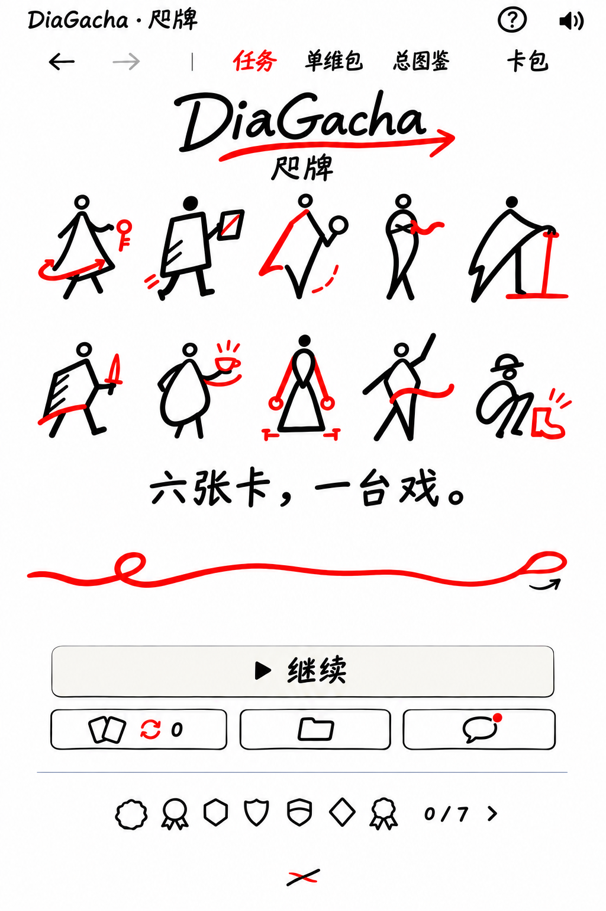
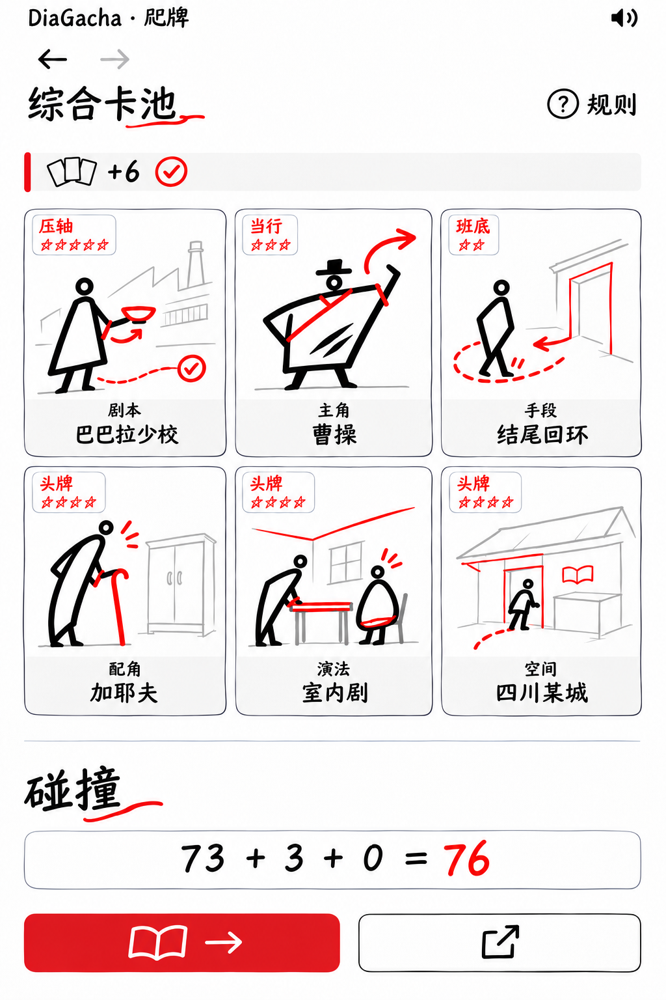

# 咫牌 · 红线视觉设计 V10

2026-11-16。本目录是可跨电脑接续的设计记录，V10 是视觉迭代编号，不是游戏发布版本。

## 直接查看

- [在线交互预览](https://canoeliu917.github.io/DiaGacha/docs/red-thread-design/2026-11-16-v10/preview/)
- [主页效果图](preview/assets/home.png)
- [六张卡面效果图](preview/assets/cards.png)
- [设计规范与接续说明](DESIGN.md)
- [本轮生成提示词](prompts.txt)
- [验证记录](VALIDATION.md)

本轮加强全部六张示例卡的人物轮廓，减淡舞台、房屋和家具线条，保留小号连笔空心星、明亮红色和选定的中英文字感；用红黑图形替代重复说明。

## 主页

## 六张示例卡

## 在另一台电脑继续

1. 在 DiaGacha 仓库切换到 `codex/scoring-v38` 分支并获取最新提交。
2. 打开本目录的 `preview/index.html` 即可离线体验，无需安装依赖。
3. 先看当前效果图与 `DESIGN.md`，再对照 V9；生成提示词可用于继续迭代。

当前预览使用固定六卡。首页为完整效果图加透明交互层，卡面采用完整裁剪，以保留已认可的字体和比例；它不是完整游戏实现。正式卡池、概率、评分和现有游戏入口未作改动。

## 对照与范围

- [V9 主页基准](comparison/home-v9.png)
- [V9 卡面基准](comparison/cards-v9.png)

这是独立的红线视觉方向；既有 `docs/figure-design/`、`docs/face-design/` 记录继续保留。本方案采用无五官几何小人，不把其他方案的表情或手办设定自动套入。

当前规范面向后续所有卡面，已制作和验证的是这里展示的六张示例；尚未逐卡重绘正式游戏的500张卡。

效果图使用内置 image_gen 生成。用户提供的参考图用于风格分析，未将第三方参考图作为本次仓库素材上传。外围HTML文字使用[霞鹜漫黑](https://github.com/lxgw/LxgwMarkerGothic)，字体许可见 [OFL](preview/assets/OFL-LXGW-Marker-Gothic.txt)。图中手写字形不是可直接安装的同名字体文件。

文件校验值见 [SHA256SUMS.txt](SHA256SUMS.txt)。
